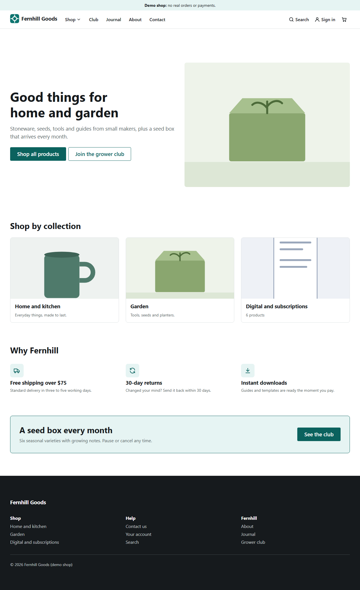
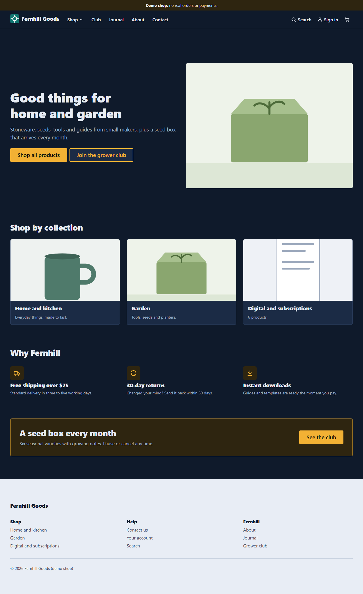

# storybook-playwright

[](https://github.com/jpiemeisl/storybook-playwright/actions/workflows/ci.yml)

A React pattern library for content sites and small shops: presentational components, page templates, a
CMS-agnostic content model, an optional commerce layer and themes. It's documented in Storybook and
protected by Playwright visual regression and accessibility tests that run against every story. Built
with Vite, React and strict TypeScript, and published privately to GitHub Packages as
`@jpiemeisl/pattern-library` (current version: [CHANGELOG.md](CHANGELOG.md)).

| `default` theme | `harbor` theme |
| --- | --- |
|  |  |

The demo shop home page, from the committed visual baselines. Every page of the demo shop is assembled
only from library pieces.

## Using the library

Host apps install `@jpiemeisl/pattern-library` from GitHub Packages. That needs a classic token with
`read:packages` locally, or `GITHUB_TOKEN` plus package access in CI, and a scoped `.npmrc`. Then import
the entry points and the CSS:

```tsx check
import '@jpiemeisl/pattern-library/tokens.css';
import '@jpiemeisl/pattern-library/core.css';
import { Button, Theme } from '@jpiemeisl/pattern-library';

export const Example = () => (
  <Theme name="harbor">
    <Button variant="primary">Get started</Button>
  </Theme>
);
```

Access, `.npmrc`, router wiring, themes, templates and commerce: [docs/consuming.md](docs/consuming.md).

## Working on the library

Requires the Node version in `.nvmrc`, and Docker for the visual and accessibility suites.

```sh
npm install
npx playwright install chromium
npm run storybook          # http://localhost:6006; start at "Demo shop / Checkpoints / Home"
npm run check:all          # every non-browser check (types, rules, docs, library build, unit tests)
npm run docker:pull        # once: the pinned Playwright image
npm run test:vrt:docker    # the visual suite, in the container
```

The **demo shop** (`Demo shop/Checkpoints/Home` in Storybook) is a complete, clickable shop: browse,
filter, add to cart, check out, sign in (demo customer `robin@example.com`, any password) and manage
subscriptions. Switch the theme in the toolbar to restyle all of it.

Before opening a pull request, follow the checklist in [docs/CONTRIBUTING.md](docs/CONTRIBUTING.md#pull-request-checklist).
How the pieces fit together: [docs/ARCHITECTURE.md](docs/ARCHITECTURE.md). Testing, Docker and
baselines: [docs/testing.md](docs/testing.md). Everything else: the [docs index](docs/README.md).

## Scripts

| Script | What it does |
| --- | --- |
| `npm run storybook` | Storybook dev server on http://localhost:6006 |
| `npm run build-storybook` | Static Storybook build into `storybook-static/` |
| `npm run check:all` | Every non-browser check, in order: typecheck, Playwright image pin, boundaries, tokens, themes, Storybook build, story tags, orphan baselines, components doc, docs, library build and check, package contents, API report, JSDoc, unit tests |
| `npm run typecheck` | `tsc --noEmit` over src, demo, .storybook, tests, scripts and config files |
| `npm run test:unit` | Vitest unit tests for pure logic (validators, registry, adapters, commerce logic, demo reducers, scripts) |
| `npm run check:boundaries` | Fails if core imports `src/commerce`, or anything under `src/` imports `demo/` |
| `npm run check:tokens` | Fails if CSS outside `src/tokens` uses primitive tokens or raw colors (allowlist: `scripts/check-tokens.allow.json`) |
| `npm run check:themes` | Fails if a theme misses a color token, adds unknown tokens or references a missing primitive |
| `npm run check:playwright-image` | Fails when `docker/image.json` pins a different Playwright version than the installed `@playwright/test` |
| `npm run check:story-tags` | After a Storybook build: fails when a main story lacks its expected screenshot tags |
| `npm run check:snapshots` | After a Storybook build: fails when a baseline file belongs to no story |
| `npm run docs:components` | Regenerates [docs/COMPONENTS.md](docs/COMPONENTS.md) from the Storybook index (`-- --check` fails when stale) |
| `npm run docs:content-model` | Regenerates [docs/content-model.md](docs/content-model.md) from the content-type JSDoc |
| `npm run check:docs` | Fails on broken links, unknown scripts, missing paths, failing checked examples, stale phrases, orphan docs and hard-coded versions ([docs/maintaining-docs.md](docs/maintaining-docs.md)) |
| `npm run check:docs:external` | Reports external links that don't respond (never fails; not in `check:all`) |
| `npm run build:lib` | Library build into `dist/`: core and commerce ES modules, CSS, token and theme CSS, type declarations |
| `npm run check:lib` | After `build:lib`: bundle boundaries, no storage, cookie or fetch use, every export declared, every `exports` target built; prints bundle sizes |
| `npm run check:package` | After `build:lib`: only the build output, README, CHANGELOG and `docs/consuming.md` would ship, and every `exports` target is included |
| `npm run api:report` / `check:api` | After `build:lib`: regenerate [docs/api-surface.md](docs/api-surface.md) / fail when it's out of date |
| `npm run check:jsdoc` | After `build:lib`: fails when a public export has no JSDoc summary |
| `npm run test:vrt:docker` | **The visual suite**: in the container, builds Storybook, then compares every story with the committed baselines |
| `npm run test:vrt:docker:update` | In the container: rewrites failing or missing baselines (the only way to write baselines) |
| `npm run test:vrt:docker:smoke` | The smoke subset, in the container |
| `npm run test:a11y:docker` | The accessibility suite, in the container |
| `npm run docker:pull` / `docker:shell` | Pull the pinned image / open a shell in the container |
| `npm run test:vrt` / `test:vrt:smoke` / `test:a11y` | The same suites on the host (expect font differences on Windows and macOS) |
| `npm run test:vrt:changed -- "<pattern>"` | Builds Storybook, then runs only tests whose title matches |
| `npm run test:vrt:flaky -- "<pattern>"` | No build: runs matching tests five times each with no retries |
| `npm run test:vrt:report` | Opens the HTML report from the last run |
| `npm run demo:break` / `demo:vrt` / `demo:fix` | The [visual regression demo](demo/vrt-regression/README.md): apply a small Button regression, run its story in the container, revert it |
| `npm run release:prepare -- <patch\|minor\|major>` | On a release branch: bump the version, date the CHANGELOG, regenerate the API report |
| `npm run release:tag` | On `main` after the release pull request merged and CI passed: tag `v<version>` and push the tag |

`test:vrt:update` exists but refuses to run outside the container; `prepublishOnly` refuses `npm publish`
outside the release workflow ([docs/publishing.md](docs/publishing.md)).

## Documentation

The [docs index](docs/README.md) lists every guide by audience: using the library, contributing and
maintaining. Open work is in [docs/ROADMAP.md](docs/ROADMAP.md), and the history of every gap in
[docs/GAPS.md](docs/GAPS.md).
