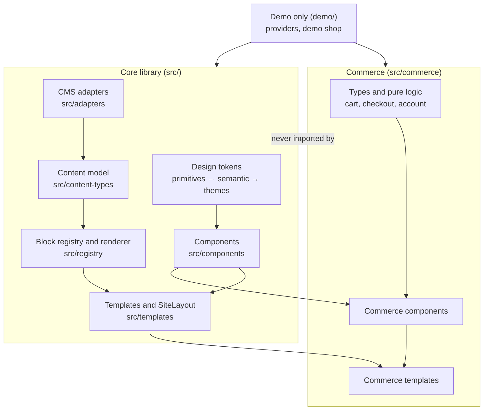
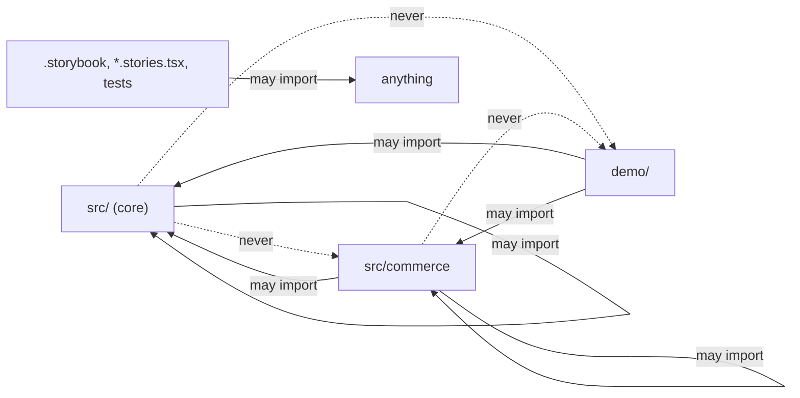
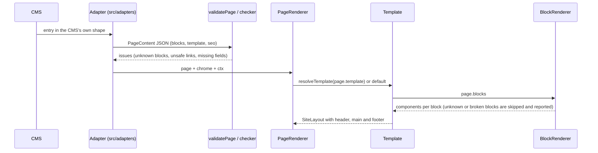
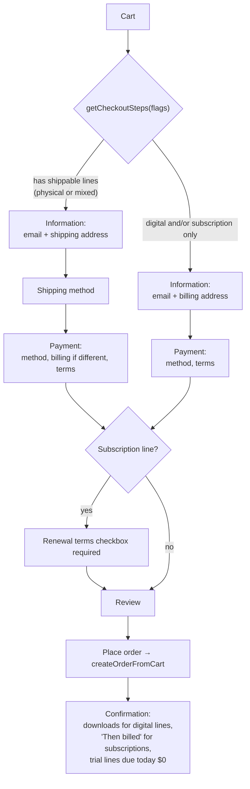

# Architecture

How the pattern library is put together, what may depend on what, and how content and checkout flow
through it.

## Layers

- **Tokens:** primitives (raw scales) feed semantic tokens (meaning), which themes override. Components
  read semantic tokens only. See [theming.md](theming.md).
- **Components** are presentational: props in, callbacks out. No fetching, storage, timers (except the
  opt-in Toast auto-dismiss) or clock reads.
- **Templates** compose components inside `SiteLayout` and take a page object plus a render context.
- **Content model and registry:** CMS-agnostic JSON blocks, validated and rendered by `BlockRenderer`.
  Adapters map a CMS's shape into the model. See [content-model.md](content-model.md).
- **Commerce** adds types, pure logic (pricing, cart totals, checkout steps, account rules), components
  and templates. It builds on core and is a separate entry point.
- **Demo** holds Storybook-only providers (in-memory cart, checkout, account) and the clickable demo
  shop. It never ships.

## Dependency rules

| Rule | Enforced by |
| --- | --- |
| Core never imports `src/commerce` or `demo/`; nothing under `src/` imports `demo/` | `npm run check:boundaries` |
| Components use semantic tokens only: no primitives, raw or named colours | `npm run check:tokens` |
| Every theme defines every colour token, nothing unknown | `npm run check:themes` |
| No component references a theme by name | `check:tokens` plus review (themes live only in `src/tokens/themes`) |
| The core bundle has no commerce, demo or fixture code; commerce imports core as an external; no storage, cookies or fetch in either bundle | `npm run check:lib` |
| Main stories keep their screenshot tags | `npm run check:story-tags` |
| The component inventory matches the stories | `npm run docs:components -- --check` (in `check:all`) |

## Content flow: CMS to rendered page

- Unsafe URLs (`javascript:`, `data:`) are refused when links and images are rendered.
- Rich text arrives as sanitized HTML (`Prose sanitizedHtml`: the adapter or backend must sanitize) or
  as structured nodes rendered without `dangerouslySetInnerHTML`.
- Problems go to `ctx.onError`; a page never crashes because of one bad block.

## Checkout flow by cart kind

- Totals always come from `computeCartTotals`; "Due today" excludes trial lines and the "Then billed"
  rows list each renewal.
- Blocking cart issues (sold out, above stock) stop checkout before the first step.
- On narrow screens a sticky bar repeats the total and the step's submit button while the real button
  is out of view (`StickyBuyBar`, tied to the same form with the `form` attribute).
