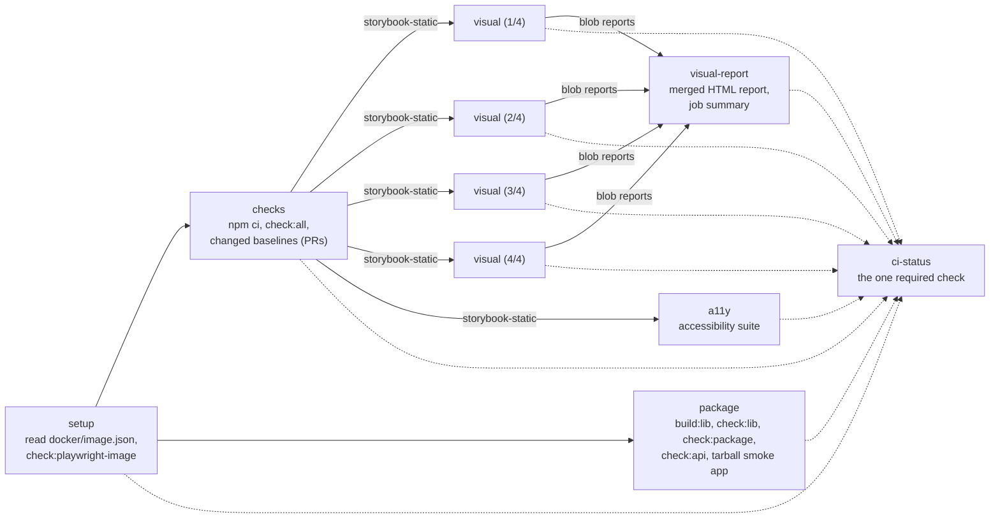

# Continuous integration

GitHub Actions runs [`.github/workflows/ci.yml`](../.github/workflows/ci.yml) on **every pull request** (any
branch) and on **every push to `main`**. Every job that runs code runs in the Playwright image pinned in
[`docker/image.json`](../docker/image.json), the same image as `npm run test:vrt:docker` locally, so CI and
your machine render identical screenshots. CI **only compares** against committed baselines; it never
writes them.

A new push to a pull request cancels that pull request's older run. Runs on `main` always finish.

## Jobs



| Job | Runs in | What it does |
| --- | --- | --- |
| `setup` | the runner (no container) | Fails if `docker/image.json` and `@playwright/test` disagree (`check-playwright-image`), then outputs the image reference (`tag@digest`). The image is defined only in `docker/image.json`. |
| `checks` | pinned image | `npm ci` (npm cache keyed on `package-lock.json`), `npm run check:all`. On pull requests, lists the baseline files the pull request changes in the job summary. Uploads `storybook-static` (kept 1 day) so Storybook is built once per run. |
| `visual (N/4)` | pinned image | Downloads `storybook-static` and runs one quarter of the visual suite (`--shard=N/4`). Always uploads its blob report; on failure also uploads `test-results-shard-N` (actual, expected and diff images, traces). Kept 14 days. |
| `visual-report` | pinned image | Runs even when shards fail. Merges the blob reports into one HTML report, uploads it as `playwright-report` (14 days), and writes the job summary: counts, failed and flaky stories, the 10 slowest stories, how to open the report. Then it fails if any shard didn't succeed, so its own status is honest. |
| `a11y` | pinned image | The accessibility suite (`playwright.a11y.config.ts`) against the same `storybook-static`. On failure uploads `a11y-test-results`. |
| `package` | pinned image | In parallel with `checks`: `build:lib`, `check:lib`, `check:package` (the packed file list goes to the job summary) and `check:api`. Then it packs the tarball and installs it into a fresh Vite + React app outside the repository (`scripts/smoke-app.mjs`), which imports core, commerce and the CSS entry points, typechecks and builds. Uploads `package-tarball` (7 days). Nothing is published; releases are [publishing.md](publishing.md). |
| `ci-status` | the runner (no container) | Always runs, after every other job. Fails if any of them failed, was cancelled or was skipped. **The only required status check.** |

Security: the token is read-only (`contents: read`) in every job; artifacts, caches and summaries need
no more. The workflow uses no secrets and never `pull_request_target`, so code from a pull request never
runs with write access. Every action is pinned to a full commit SHA with its version in a comment.

## Reading a failure

1. Open the failed run (the pull request's **Checks** tab, or **Actions**), then the **Summary** page. The
   `visual-report` summary lists the failed stories, flaky ones and the slowest ones.
2. At the bottom of the Summary page, under **Artifacts**, download `playwright-report` (and, for the
   raw images, `test-results-shard-N` of the failing shard).
3. Unzip it and open it from the repository:

   ```sh
   npx playwright show-report path/to/playwright-report
   ```

   Each failing story shows the expected, actual and diff images (use the slider), the steps and the trace.
4. Decide: a regression (fix the code) or an intended change (update the baselines, below).

The `checks` and `a11y` failures are in the job log; `a11y-test-results` holds traces for accessibility
failures.

## Updating baselines

CI never writes baselines: the update scripts refuse whenever `CI` is set, with no override
(`scripts/vrt-guard.mjs`, tested in `scripts/vrt-guard.test.ts`). Update them locally, in Docker, and
commit them with the code that changed them:

```sh
npm run test:vrt:docker:update        # rewrites failing or missing baselines in the pinned image
git add tests/visual/__screenshots__
git commit                            # together with the component change
```

On the pull request, the `checks` summary lists the changed baseline files and their count so reviewers
notice them; the **Files changed** tab shows image diffs. See [testing.md](testing.md) for the Docker
setup.

## Re-running a job

On the run page, **Re-run jobs** → **Re-run failed jobs** (or **Re-run all jobs**). A single job can be
re-run from its own page (the circular arrow). The `storybook-static` artifact is kept for one day: after
that, re-run all jobs so `checks` builds it again. A flaky test is retried once in CI (`retries: 1`) and
reported as flaky in the summary instead of failing the run.

## Dependabot

[`.github/dependabot.yml`](../.github/dependabot.yml) opens pull requests weekly:

- **GitHub Actions:** keeps every action pinned to a commit SHA and updates the SHA and its version comment.
- **npm:** minor and patch updates grouped into one pull request; majors come one by one.
- **Excluded:** `@playwright/test` (and `playwright`, `playwright-core`). A Playwright bump changes the
  browser, so it must update `docker/image.json` (the image tag and digest) and regenerate every baseline
  in the same pull request. Dependabot can't do that, and it doesn't read `docker/image.json`, so the image
  is never bumped automatically either. Follow "Bumping the Playwright version" in
  [testing.md](testing.md). Storybook **major** versions are excluded too: they are migrations.

## Branch protection (manual)

The workflow can't enforce these; set them in **Settings** → **Branches** → **Add branch ruleset** (or
**Add classic branch protection rule**) for `main`:

1. **Require a pull request before merging.** Optionally require one approval.
2. **Require status checks to pass**, and add **only `ci-status`** (it appears in the list after the first
   run). Why only that one:
   - `visual` is a matrix, so it reports one check per shard (`visual (1/4)` … `visual (4/4)`). Listing
     them ties branch protection to the shard count, and changing the count would leave pull requests
     waiting for checks that no longer exist.
   - A **skipped** job counts as passing for branch protection. When `setup` or `checks` fails, the jobs
     after it are skipped, so a rule that requires only those later jobs (or `visual-report`) could let a
     broken pull request through.
   - `ci-status` runs with `if: always()`, needs every job, and fails if any of them failed, was cancelled
     or was skipped, so one check covers the whole workflow whatever its shape.
3. **Require branches to be up to date before merging** (in classic rules: tick it under the status
   checks setting; in rulesets: "Require branches to be up to date before merging").
4. Optionally **Block force pushes** and **Restrict deletions** for `main`.

When you add, remove or rename a job in `ci.yml`, update the `needs` list of `ci-status` (every other job
must be in it). Don't rename `ci-status` itself without updating the required check, or pull requests will
wait forever for a check that no longer exists.

## Timings

Measured on the first green run of this workflow (GitHub-hosted `ubuntu-24.04`, 4 vCPUs, 2 Playwright
workers per job):

| Job | Time |
| --- | ---: |
| `setup` | 13 s |
| `checks` | 1 min 12 s |
| `visual (1/4)` … `visual (4/4)` (in parallel) | 2 min 30 s to 3 min 30 s each (tests 2 to 2.8 min) |
| `visual-report` | 44 s |
| `a11y` (in parallel with the visual shards) | 7 min 39 s |
| **Whole run** | **9 min 11 s** |

The critical path is `setup` → `checks` → `a11y`: the accessibility suite (928 tests in one job) takes
longer than the sharded visual suite plus its report. Pulling the image takes about 20 s per job.
