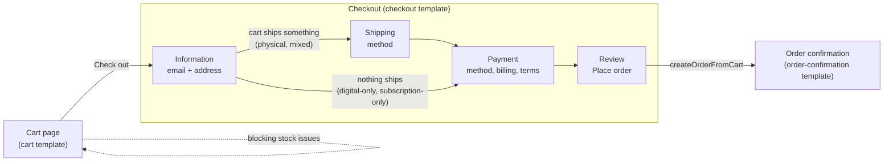

# Commerce: cart and checkout

Phase 11 (hand-written). This covers the cart, the multi-step checkout and the order confirmation. Everything lives in [`src/commerce`](../src/commerce), except `Toast`, which is generic and in the core library. As before, the core library never imports commerce (`npm run check:boundaries`).

There is no backend and no payment handling: the templates take data and call back.

## The purchase flow



### Steps by cart kind

`getCheckoutSteps(totals.flags)` decides the steps.

| Cart | Steps | Address on Information | Payment step extras |
| --- | --- | --- | --- |
| Physical only | Information, Shipping, Payment, Review | Shipping address | "Same as shipping" billing checkbox |
| Digital only | Information, Payment, Review | Billing address (explained in text) | Digital delivery note |
| Subscription only | Information, Payment, Review | Billing address | Renewal and cancellation checkbox |
| Mixed (anything with a physical line) | Information, Shipping, Payment, Review | Shipping address | Billing checkbox, plus the digital note and renewal checkbox when relevant |

A subscribe-and-save line on a physical product counts as physical: it ships.

**Billing address model.** Every payment needs a billing address.
- If something ships, billing defaults to "same as shipping". A separate billing address is required on Payment only when that box is unticked.
- If nothing ships, there is no shipping address, so the billing address is collected on Information instead.

Hosts whose payment provider collects billing details itself pass `{ collectBillingAddress: false }` to `validateCheckoutStep` and `canEnterStep`.

## CheckoutValues

It is JSON-serializable, so the host can keep it wherever it likes. The library never stores it.

```ts
interface CheckoutValues {
  email: string;
  marketingConsent?: boolean;          // never pre-ticked
  shippingAddress?: Address;           // US only; region = 2-letter state code
  billingSameAsShipping: boolean;
  billingAddress?: Address;
  shippingMethodId?: string;
  paymentMethod?: 'card' | 'wallet';   // the type only, never card data
  termsAccepted: boolean;
  subscriptionTermsAccepted?: boolean; // required when the cart has subscription lines
}
```

`CheckoutErrors` maps field keys to messages, for example `email`, `shippingAddress.postalCode` and `termsAccepted`.
- `validateCheckoutStep(step, values, flags)` returns the errors for one step, in form order. The wording comes from the shared `getFieldError` helper.
- `canEnterStep` is true only when every earlier step is valid.
- `firstInvalidStep` finds where to send the customer.

## Wiring it to a host app

```tsx
import { createTemplates, PageRenderer } from '@jpiemeisl/pattern-library';
import { commerceTemplates, computeCartTotals, getCartIssues, getCartNotes, createOrderFromCart, firstInvalidStep } from '@jpiemeisl/pattern-library/commerce';

const templates = createTemplates(Object.values(commerceTemplates));
```

### Cart (`template: 'cart'`)

The page is `{ cart, totals, issues, notes?, crossSell?, status?, lineStatus?, links? }`.
- `totals` comes from `computeCartTotals`. The template does no pricing.
- `issues` comes from `getCartIssues(cart, currentCatalogue)`. Blocking issues disable Check out with a visible reason, and the alert links to each affected line.

The callbacks go in `ctx`:
- `onQuantityChange`, `onRemoveLine`, `onApplyPromo` (return `{ ok, message }`, or a promise of it)
- `onRemovePromo`, `onCheckout` (without it, Check out is a link to `links.checkout`)
- `onSaveForLater`: a callback slot only
- `lineHref`

### Checkout (`template: 'checkout'`)

The page is `{ cart, totals, step, values, errors?, shippingMethods, issues?, status, errorMessage?, links? }`. Wire it like this:
- `ctx.onCheckoutChange(values)`: store the values. When `shippingMethodId` changes, recompute totals with that method.
- `ctx.onStepChange(step)`: route to the step, for example `/checkout/payment`. The template validates before calling it, and completed steps call it to go back. Never route forward past a step that `canEnterStep` rejects.
- `ctx.onPlaceOrder()`:
  1. Run `firstInvalidStep` again on the server.
  2. Confirm the payment with your provider.
  3. Create the order through your order API.
  4. Set `status: 'submitting'` while waiting, and `status: 'error'` with an `errorMessage` on failure.
  5. On success, route to the confirmation.
- `ctx.paymentFields`: your payment provider's hosted fields. See the security rule below.
- An empty cart or blocking issues render a guard that links back to the cart.

The template uses the core `SiteLayout` `minimal` variant (logo-only header and legal footer).

### Payment fields: security rule

**This library never renders card number, expiry or CVC inputs.** `PaymentMethodSelector` only records the type (`card` or `wallet`) and renders `ctx.paymentFields` (or its `paymentFields` prop) under the selected method. Production hosts must put the provider's hosted fields (iframes) in that slot, so card data never touches this code.

`DemoPaymentFields` is a static panel with no inputs: "Payment fields from your payment provider appear here. Demo only: no payment is taken." A story checks that the selector contains no text inputs.

### Confirmation (`template: 'order-confirmation'`)

The page is `{ order, links? }`. Build the order with `createOrderFromCart(cart, values, { orderId, orderNumber, placedAt, promoDefinitions, shippingMethods, products })`. The caller supplies the ids and the time: the function never reads the clock or generates ids.
- Digital lines become `downloads`.
- Subscription lines become `recurring` (first billing date, trial end, a ready-made note).
- Shippable carts get the shipping address and method.
- When trials make today's charge smaller, `totals.dueToday` is set.

Download links default to `href="#"` placeholders that never navigate. Pass `hrefFor` to `DownloadList` with your signed URLs. The "A confirmation would be emailed to …" line is demo wording, shown only when `order.email` exists. Nothing is sent.

### Validation

These check page data before rendering:
- `validateCartPage(page, cartContext)`: totals equal `computeCartTotals`, issues point at real lines, links are safe.
- `validateCheckoutPage(page, cartContext)`: as above, plus the step exists for this cart and the chosen shipping method is offered.
- `validateConfirmationPage(page)`: everything `validateOrder` checks, plus the new `email`, `dueToday` and `recurring` fields.

## Toast (core)

- `ToastRegion` goes once per page. Normal toasts go in a polite `role="status"` container and `urgent` toasts in a `role="alert"` one. Both containers always exist, so additions are announced. Nothing takes focus.
- Auto-dismiss is off unless `duration` is set. When set, it pauses on hover and while focus is inside, restarts in full afterwards, and never runs while the page is hidden. No story enables it.
- Up to 3 toasts show. Older ones collapse behind "+N more".
- **Keeping focused content visible:** while toasts are shown, an effect measures how far the stack reaches up the viewport and sets `--toast-stack-size` on `<html>`. The stylesheet turns that into `scroll-padding-block-end`, so focusing or scrolling to an element stops above the stack rather than under it.
- **Placement:** the stack sits above a `StickyActionBar` automatically, through a new `data-sticky-action-bar` attribute. Hosts can add `--toast-offset-block-end` for other bars.
- `useToasts()` keeps toasts in memory, through the pure, tested `toastReducer`.

## What the demo provider does and does not do

`DemoCommerceProvider` (Storybook only, in `demo/`) adds two hooks:
- `useDemoCheckout()` keeps values, step, errors and status in memory. `placeOrder()` validates every step, then calls `createOrderFromCart` with deterministic ids (`ord-2026-2101`, `FH-2101`, …; `placedAt` = `DEMO_NOW`) and stores the result as `lastOrder`. A failure happens only when the story sets `parameters.demo.failPlaceOrder`.
- `useDemoToasts()` turns cart actions (added, removed, promo applied or rejected) into toasts. It uses no timers.

The demo does not:
- persist anything
- call a payment provider
- reserve stock
- calculate real tax: it uses a flat 8% estimate
- send email
- show a real "submitting" delay: the Submitting story sets the status directly

## Deterministic fixture values

| Value | Fixture |
| --- | --- |
| Order ids and numbers | `orderContext(n)` → `ord-2026-<n>`, `FH-<n>`. Confirmation fixtures use 2001–2006; demo orders start at 2101. |
| Time | `DEMO_NOW` = `2026-03-21T09:00:00Z`. Trials and renewals count from it (for example, a 14-day trial ends Apr 4, 2026). |
| Free-shipping boundary | `carts.freeShippingBelow` ($74.99) and `carts.freeShippingAt` ($75.00) |

## Gap report

What the library lacked and how it was filled:

- **Toast** is new in core: `ToastRegion`, `Toast`, `useToasts` and `toastReducer`.
- **Icons:** cart, bag, trash, lock, credit-card, wallet, package. `info`, `alert-triangle` and `check-circle` already existed.
- **Additive type changes:**
  - `CartLineSnapshot.compareAtPrice`, so cart lines show sale prices.
  - `RecurringCharge.trialDays`, for trial notes in "Then billed".
  - On `Order`: `email`, `totals.dueToday`, `recurring` and download `format`/`sizeBytes`. `validateOrder` checks them all.
- **New pure helpers:**
  - `summaryRows` and `thenBilled`: the totals rows, which always add up to "Due today".
  - `getCartNotes`, `orderLineAmounts`, `billingAddressFor`, `firstInvalidStep`, `US_STATES`.
- **Core change:** `StickyActionBar` gained a `data-sticky-action-bar` attribute, so toasts can sit above it.
- **No new tokens.**

### Workarounds and decisions to review

1. **Estimated shipping before an address.** `computeCartTotals` always includes an estimated shipping cost. If the summary said only "Calculated at checkout", its rows wouldn't add up to "Due today". So before an address is known, the row reads "Estimated shipping $5.95 / Standard. Calculated at checkout from your address."
2. **Free shipping applies to every method.** `computeCartTotals` zeroes shipping for whichever method is chosen once the threshold or a code applies. `ShippingMethodSelector` therefore takes `freeMethodIds` and marks them all as free.
3. **Review step shows the items itself.** The order summary sidebar is left out on Review, so the items and totals aren't on screen twice.
4. **OrderSummary open state.** A media query listener in an effect (64rem, matching the two-column layout) keeps the native `<details>` open on wide screens. Before it runs, and without JavaScript, the summary starts closed.
5. **Quantity steppers.** They show only for physical lines, including subscribe-and-save, where quantity matters. Digital and subscription products show "Qty N" as text. For lines above stock, the stepper keeps the real quantity visible and only allows decreasing.
6. **CartLineItem has 10 props.** The error message is fixed text rather than an 11th prop.
7. **Checkout needs JavaScript.** Steps are links (`?step=…`) when there is no `onStepChange`, but the forms are controlled and have no no-JavaScript submit path. The cart's promo form does post natively (field `promo`).
8. **Busy line items** use a muted background, not reduced opacity. Reduced opacity failed text contrast in the accessibility check.

### Deferred

- Save for later: a callback slot only, as asked.
- Address autocomplete or verification, and non-US addresses.
- Real tax: the flat 8% demo estimate is labelled "Estimated tax".
- ~~A sticky mobile checkout bar~~: shipped in Phase 14 (below).

## Known limitations

- **Checkout requires JavaScript.** The step forms are controlled and have no plain-form fallback. Only the cart's promo code form submits natively (field `promo`).
- **Free shipping applies to every method** once the $75 threshold (or a free-shipping code) is met, because `computeCartTotals` zeroes shipping for whichever method is chosen. The shipping selector marks every method as free to match.
- **US addresses only.** Fifty states plus DC, ZIP or ZIP+4.
- **Tax is a labelled 8% demo estimate** ("Estimated tax"). Real tax needs the address and a tax service.
- **Deferred:** save-for-later (a callback slot only).

## Sticky checkout bar (Phase 14)

Below 48rem, while the step's real submit button is out of view, `StickyBuyBar` shows "Due today" and the step's primary button. That button is `type="submit"` with the `form` attribute pointing at the step form, so submitting runs the same validation and handler: there is no second code path, and the real button stays the form's default (Enter in a field) because it comes first in the document. Same rules as the product bar: hidden where IntersectionObserver is unsupported, scroll padding while shown, safe-area inset, below toasts and the cookie banner, not printed, and absent while the cart is empty or blocked.
