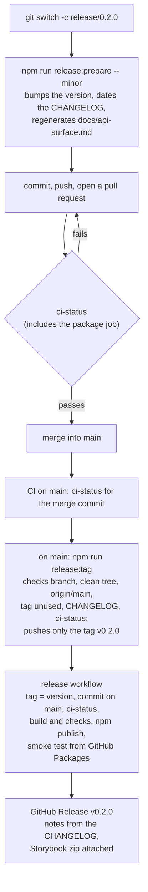

# Publishing

How `@jpiemeisl/pattern-library` is released to GitHub Packages. This page is for maintainers; consuming
projects read [consuming.md](consuming.md). What a version number promises is in
[versioning.md](versioning.md).

**The rules:**
- A version is published only by the release workflow (`.github/workflows/release.yml`), only from a
  `v<version>` tag on a commit that is on `main` and passed `ci-status`.
- A published version's number and tag are never reused or moved.
- The package stays **private**. The repository is public, so its branch and tag rulesets are enforced
  on the Free plan, and **a package first published from this public repository comes out public**.
  The first version (0.1.0) came out public and was switched to private by hand right afterwards. <!-- check-docs: version-ok -->
  Visibility is set per package, not per version, so later versions stay private. A brand-new package
  (for example a future adapter package published from this repository) must be set to private right
  after its first publish (see "Package settings" below). Never switch a package to public on purpose:
  GitHub's docs warn that a public package can't be made private again.

## Release flow



Step by step:

1. **During normal work**, every pull request that changes the package adds a line under
   `## [Unreleased]` in [CHANGELOG.md](../CHANGELOG.md), in Added, Changed, Deprecated, Removed, Fixed or
   Security. If `docs/api-surface.md` changes in a pull request, its CHANGELOG line says how.
2. **Pick the bump** from [versioning.md](versioning.md). Before 1.0.0, breaking means minor.
3. **Prepare** on a release branch (main is protected, and the script refuses to run there):

   ```sh
   git switch main && git pull
   git switch -c release/0.2.0
   npm run release:prepare -- minor      # or patch, major
   ```

   It refuses on `main` or a detached HEAD, with uncommitted changes to tracked files, when the new
   version's tag already exists locally or on `origin` (or `origin` can't be reached to check), when
   the Unreleased section has no notes, and when CHANGELOG.md already has a section for the new version. Then it runs
   `npm version <bump> --no-git-tag-version --ignore-scripts` (package.json and package-lock.json), moves the Unreleased
   notes under `## [0.2.0] - <today>`, updates the comparison links, rebuilds the library and
   regenerates `docs/api-surface.md`. It commits nothing.
4. **Review and open a pull request:** `git diff`, then commit, push and open it. CI runs as usual,
   including the `package` job, which installs the packed tarball into a fresh app.
5. **Merge** once `ci-status` passes. CI runs again on `main` for the merge commit.
6. **Tag** once that run is green:

   ```sh
   git switch main && git pull
   npm run release:tag
   ```

   It checks, in order:
   - you are on `main`, the tree is clean, and local `main` equals `origin/main`;
   - `v<version>` doesn't exist yet, locally or on origin;
   - CHANGELOG.md has notes for the version;
   - `ci-status` passed for HEAD. This uses `gh api`. Without `gh`, it prints how to check by hand and
     requires `npm run release:tag -- --confirm-ci`.

   It then creates the annotated tag and pushes only that tag.
7. **Watch the release workflow** (Actions, then Release). It checks again that the tag equals
   `v` + the package.json version, that the commit is on `main`, and that `ci-status` passed. Then it
   runs `npm ci`, `build:lib`, `check:lib`, `check:package`, `check:api` and `test:unit`, and publishes
   with `RELEASE_WORKFLOW=1` and the workflow's `GITHUB_TOKEN`. After that:
   - It installs the new version from GitHub Packages into a fresh app and builds it.
   - It creates the GitHub Release with that version's CHANGELOG section as notes and the static
     Storybook build attached as `storybook-v<version>.zip` (unzip it, then open `index.html`).

Nothing else can publish:
- `package.json` sets `publishConfig.registry` to GitHub Packages, so a publish can never go to npmjs.org.
- `prepublishOnly` runs `scripts/release-guard.mjs`, which refuses unless `RELEASE_WORKFLOW=1`. Only the
  release workflow sets it. A local `npm publish`, or even `npm publish --dry-run`, stops with that
  message.
- No token with `write:packages` is stored anywhere. The workflow uses its own short-lived
  `GITHUB_TOKEN`.

## Dry run

A dry run runs the same verification, build and checks, then `npm publish --dry-run`, and builds the
Storybook zip. It skips the smoke test from GitHub Packages and the GitHub Release. The publish step's
log lists every file that would be published, and the job summary shows the package contents and the
release notes. Nothing is published, and no release is created.

```sh
gh workflow run release.yml -f dry_run=true          # current main
gh run watch                                          # pick the run
```

Without `gh`: Actions → Release → **Run workflow**, keep "Dry run" ticked. A dry run still requires the
commit to be on `main` with a green `ci-status`. A real publish from **Run workflow** works only when
you choose a version tag as the ref. From a branch, dispatching with the box unticked fails on purpose.

## When a release fails

Find the failing step in the run.

- **Before "Publish to GitHub Packages"** (verification, build or checks): nothing was published. Fix
  the cause on `main` through a pull request. Then:
  - If the fix didn't change the package (for example a workflow fix), delete the tag
    (`git push origin :refs/tags/v0.2.0` and `git tag -d v0.2.0`; only an admin can, because of the tag ruleset)
    and run `npm run release:tag` again on the new HEAD. Re-running the old run isn't enough: it would
    release the old commit.
  - If the fix changed the package, prepare the next patch instead. It is the safer default.
- **"Publish" failed**: check the log. "Cannot publish over previously published version" means the
  version already exists; prepare the next version. An auth error (401/403) usually means the package's
  settings don't give this repository write access (see "Package settings" below). Fix that, then
  **Re-run jobs** on the same run.
- **After publish** (smoke test, Storybook build or GitHub Release failed): the version is published.
  Never delete it and publish the same number again. Consumers or caches may already have it.
  - Re-run the failed jobs if the failure was transient.
  - Or create the GitHub Release by hand: `gh release create v0.2.0 --verify-tag --notes-file <(node scripts/release.mjs notes 0.2.0)`.
  - If the published package itself is broken, publish the next patch (0.2.1) with the fix and deprecate
    the broken version (below).

**Never reuse a version number, and never move or re-point a tag that was published.** Always fix
forward with the next patch.

## Deprecating a version

1. Publish the fixed version first (normally the next patch).
2. Add a "Deprecated" note to that version's CHANGELOG entry, naming the bad version and why.
3. Edit the bad version's GitHub Release, and add a warning at the top pointing to the fixed version.
4. Try `npm deprecate @jpiemeisl/pattern-library@0.2.0 "Broken CSS export; use 0.2.1"` with a classic <!-- check-docs: version-ok -->
   token that has `write:packages`, set in your user `.npmrc` (never in the repository). GitHub's docs
   don't say whether the npm registry on GitHub Packages supports `npm deprecate`. If it refuses, steps
   2 and 3 are the deprecation.
5. Deleting a version (package page → **Package settings** → **Manage versions**) is a last resort, for
   a version that must not be installed at all, such as one that leaked something sensitive. Deleted
   versions can be restored within 30 days. Don't publish the same number again either way.

## Package settings (once, after the first publish)

On GitHub: your profile → **Packages** → `pattern-library` → **Package settings**:

- **Danger Zone → Change visibility**: must say "This package is currently private". The first publish
  from this public repository comes out **public**, so right after a new package's first release:
  **Change visibility** → **Private** → type the package name → confirm. Then check that
  `https://github.com/<owner>/<repo>/pkgs/npm/<package>` returns 404 in a signed-out browser.
- **Manage Actions access**: `storybook-playwright` should already be listed, because its workflow
  published the package. Make sure its role is **Write** or **Admin**. That is what lets the release
  workflow publish later versions and run the smoke test.
- To let another repository's workflows install the package, add it there with the **Read** role. The
  steps are in [consuming.md](consuming.md#in-a-consuming-repositorys-github-actions).
- **Inherit access from source repository**: the package then gets the repository's collaborators'
  access (not its visibility). With a public repository this setting affects access only. Visibility
  stays as set above.

## Tag ruleset

A pushed `v*.*.*` tag starts a release, so only admins can create, move or delete release tags. The
active tag ruleset `release tags` targets `v*`, restricts creations, updates and deletions, and has
**Repository admin** on its bypass list. A personal repository on the Free plan supports rulesets
because the repository is public. To recreate the ruleset:

1. Open the repository on GitHub → **Settings**.
2. In the sidebar, under **Code and automation**, click **Rules** → **Rulesets**.
3. Click **New ruleset** → **New tag ruleset**.
4. **Ruleset name**: `release tags`. **Enforcement status**: **Active** (the default, Disabled, does
   nothing).
5. **Bypass list** → **Add bypass**, then select **Repository admin** → **Add selected**. Only admins
   (you) can then push, move or delete matching tags.
6. **Target tags** → **Add target** → **Include by pattern**, and enter `v*`.
7. **Rules**: tick **Restrict creations**, **Restrict updates** and **Restrict deletions**. Leave the
   others off.
8. Click **Create**.

A collaborator without admin rights who pushes a `v*` tag is rejected. An admin's `npm run release:tag`
works because admins are on the bypass list.

## Bumping Playwright or Storybook without changing the package

The Playwright image, Storybook, Vitest and the other dev tools are **not** part of the package's
public API. The package has no runtime dependencies, and its peers are only `react` and `react-dom`.
Bumping them is a normal pull request:

- **Playwright:** follow "Bumping the Playwright version" in [testing.md](testing.md). It changes
  `@playwright/test`, `docker/image.json` and the baselines together.
- **Storybook:** bump all `storybook` and `@storybook/*` packages together. Majors are migrations
  (Dependabot skips them). Run `npm run check:all` and the visual suite in Docker.

Before merging, confirm that the bump didn't touch the package:
- `npm run check:api` passes without regenerating `docs/api-surface.md`, so the API is unchanged.
- The `package` job passes. It checks the packed contents and builds the tarball in a fresh app.
- The bundle sizes that `check:lib` prints are about the same.

If all three hold, no release is needed. If you release anyway, for example so the attached Storybook
zip shows the new Storybook, it's a **patch** with a "Changed" note: "Tooling only; no API change."
